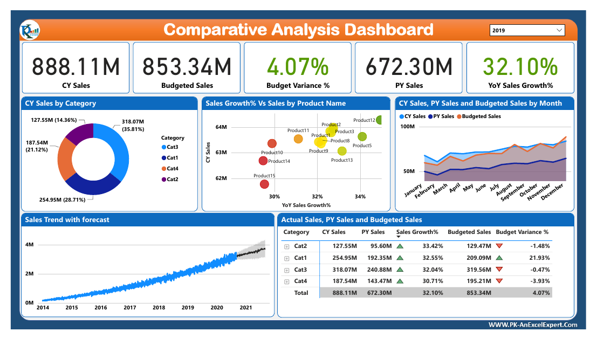

# Comparative Analysis Dashboard (Budget vs Actual)

Power BI dashboard comparing current-year sales, previous-year sales and budget by category, product and month.

## What it shows
- Current-year sales vs budgeted sales with budget variance %
- YoY sales growth % by category and product
- Monthly CY / PY / budget comparison and a sales trend with forecast

## Files
- `Comparative Analysis Dashboard.pbix`: Power BI report (open in Power BI Desktop)
- `Comparative Analysis Dashboard.pdf`: exported PDF of the report
- `data/`: source data. Budget and Sales Data.xlsx (included).

## Tools
Power BI, DAX, Power Query.

## Author
Asad Ullah, Data Analyst and Power BI Developer, Dammam, Saudi Arabia
[LinkedIn](https://linkedin.com/in/asadullah44) | [Portfolio](https://asadullah-the-analyst.netlify.app) | [GitHub](https://github.com/asadullah43)
